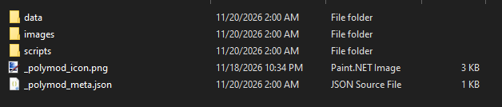

# Manually "compile" the modpack (On Windows, and with no 7z):

Make a folder under your funkin' folder in the following place `path/to/funkin/mods/CharsHUDPack/`

copy the contents of `mod_pack/assets/` and `mod_pack/metadata/` to `path/to/funkin/mods/CharsHUDPack/`

And copy `mod_pack/source/` to `path/to/funkin/mods/CharsHUDPack/` and rename it to `scripts`

final folder should look something like:

